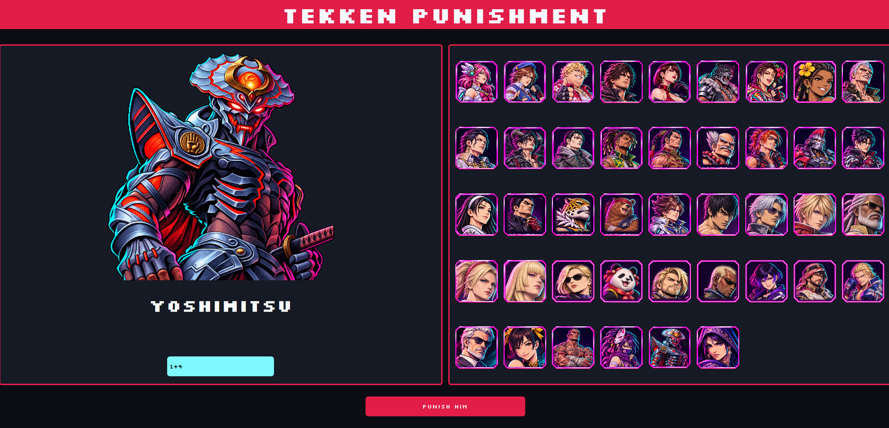
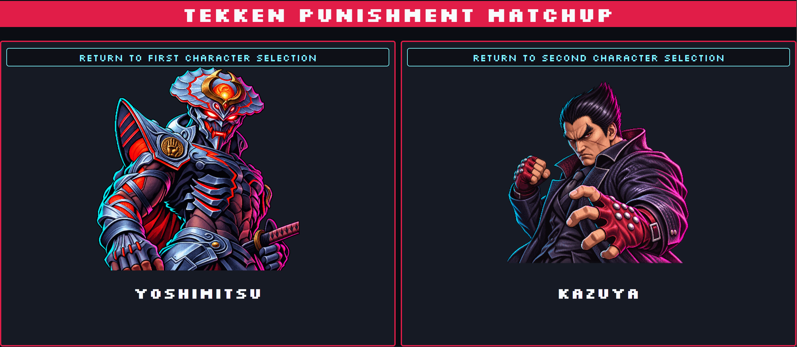
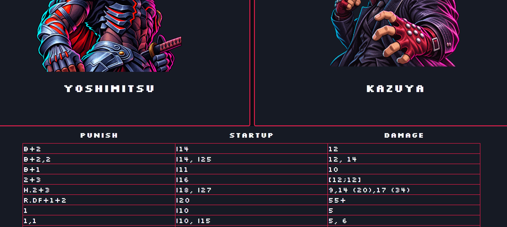

# Tekken Punishment 

## What is Tekken Punishment ?

Tekken is a fighting game where, the frame data and timing are crucial to win the game. Every character has more than 100 moves, each one with different values.

Depending on the move the opponent can punish, or not, certain moves, depending on the frame advantage.

Because of that, memorizing about every punish for every move of the 43 characters on the game, can be a massive knowledge check. 

This web application is built to help  any player that want to know how to punish a move of an opponent character with their favourite character.

Users can:
- Opponent character (The character they want to know how to punish)
- Move of the opponent
- Their own character (The character you want to use on the punishment)

## Screenshots

## Getting started
What do you need to do to run up my project? 
Depending on your IDE, the setup setups may vary.

If you want to run it from your terminal, you will need, at least:
- Git
- Node.js
- Docker desktop
- Java (I used JDK 25)

First, clone the repository

- git clone https://github.com/alejandromome/Tekken8-punishment

You will se it is organized like this:

Tekken8/
├── backend/
├── frontend/
├── docker-compose.yml
└── .env.example

Create your own .env for the database configuration with the template given:
- Copy-Item .env.example .env

Start docker and get to backend to initialize the Spring Boot App:
- docker compose up -d
- cd backend
- .\mvnw.cmd spring-boot:run

Now, navigate to the frontend, install de dependencies and start the server:
- cd frontend
- npm ci
- npm run dev

Get to your browser and type:
- http://localhost:5173/

If you want to test the Application, return to the backend and let maven run de tests:
- cd backend
- .\mvnw.cmd clean test

The cd commands shown assume you are at the root of the project, otherwise, simply adjust them with the correct path.

## Tech Stack
The application is built using:

### Database
PostgreSQL, Docker.

### Backend
SpringBoot & Java.

### Frontend
React, CSS, JavaScript, node.js & Vite.

### Testing
Junit & Mockito.

### Build Tools

Maven, npm.

## Technical Decisions

### Why this stack?

My first idea was to create a backend project to learn how databases are designed, created and used. As this was my 
first independent project outside university, I did not know which technologies to use on this project. 
Then, why use Java (Spring Boot) and React? Because, at least in Spain, they are widely used in the industry.

As this was my first independent project, I prioritized learning widely 
adopted technologies rather than comparing frameworks based on performance or optimization.

As I said, it was a backend project, but some friends want it to use the application, and they not know how to 
work with a database. That is the reason why this project also has a frontend part 
(chose React for the exact reason that Java).

### Architecture
The application follows the client-server architecture, with a backend on a layered structure, as you can see on how the
responsibilities are distributed  [controllers --> services --> repositories --> database].

Also, I used Mappers and DTOs as the rules of SoC dictates.

## Challenges

- CSV and Parse: Handling CSV files, with the characteristic annotations of a fighting game, helped me solidify
my knowledge about parsing and the use of regular expressions.
- Migrating from H2 to PostgreSQL: The project started on an H2 for simplicity, after the inclusion of a frontend, I decided to
migrate to PostgreSQL, which allowed me to learn about docker, connections and how useful is SpringBoot for this.
- Integrate frontend with backend: I learned how HTTP requests are created (and responded) and how to use 
REST endpoints.
- Testing: With the creation of automated test, I learned how powerful JUnit and mockito are for testing behaviours 
and logic.

## What remains to be implemented

- Add filters and sorting options on the punishment moves.
- Personalized the background of each character portrait.
- Increase test coverage.
- Implement exception handling.
- Improve de API security before a public deployment.

# Author
## Alejandro Molina Merino
[GitHub](https://github.com/alejandromome) | [LinkedIn](https://www.linkedin.com/in/alejandro-molina-merino-84b452180)